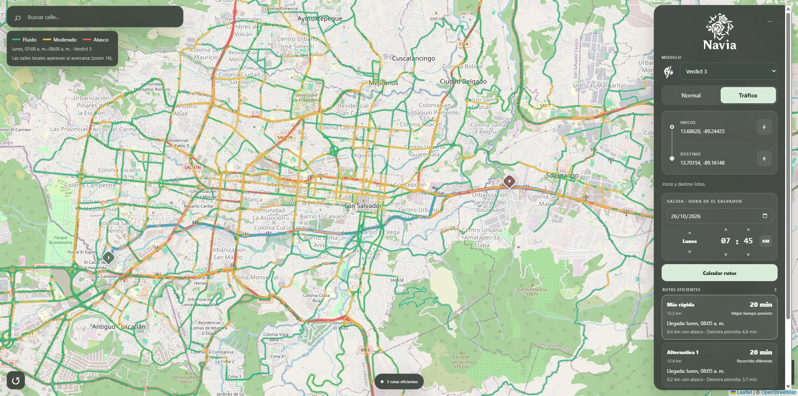

  

  <h3>Navegación Adaptativa Vial con Inteligencia Artificial</h3>

  

    
    
    
    
    
  

  
<strong>v0.1.1 · Many-Flowered Rose</strong>

##  ¿Qué es Navia?

Navia es un planificador de rutas para El Salvador que combina una red vial local con estimaciones de tráfico para encontrar recorridos con menor tiempo de viaje

Las carreteras se evalúan según la hora prevista de paso por cada tramo. Si un viaje comienza a las 7:00 y llega a otra zona a las 11:00, Navia utiliza las condiciones estimadas para esa hora al calcular el recorrido

La ruta principal prioriza el tiempo total de llegada: puede atravesar tráfico si hacerlo resulta más rápido que evitarlo

##  Vista de tráfico

La vista tráfico permite explorar las condiciones estimadas para la fecha y hora seleccionadas:

- 🟢 **Fluido**
- 🟡 **Moderado**
- 🔴 **Atasco**

Las calles locales aparecen al acercarse al mapa para mantener una vista más clara al explorar zonas amplias

##  Características

- Hasta tres opciones de ruta con diversidad geográfica, cuando existen alternativas suficientemente eficientes
- Cálculo de tiempos con tráfico, considerando las velocidades previstas durante el recorrido
- Selección de fecha y hora, con controles de horas, minutos y AM/PM
- Búsqueda local de calles y selección de inicio y destino sobre el mapa

##  Impulsado por Verdict 3

### 46,1 millones de parámetros espaciotemporales

Parámetros estadísticos que representan el tráfico mediante combinaciones de:

- 274.229 tramos de carretera
- 7 días de la semana
- 24 horas del día

Navia incluye el modelo y la red vial preparada necesarios para ejecutar las predicciones y calcular las rutas

## Información extra

Puede obtener más información técnica sobre el proyecto consultando nuestro PDF informativo haciendo clic <a href="docs/Info.pdf">aquí</a>

##  Instalación

### Requisitos

- Windows
- Python 3.12+
- Conexión a Internet para instalar las dependencias y cargar el mapa base

### Descargar e instalar Navia

1. Descargar el paquete completo desde [Releases](https://github.com/SpringdanceShrub/Navia/releases) y extraer el ZIP
2. Hacer dobre click sobre **`Navia.bat`**
3. Espera mientras prepara el entorno y abre Navia en el navegador

El archivo crea `.venv` si hace falta, instala las dependencias de `requirements.txt` dentro de ese entorno, comprueba el modelo y la red, e inicia el servidor en CPU. Abre el navegador cuando el servidor ya responde.

Para volver a usar Navia, ejecuta otra vez `Navia.bat`. Reutiliza el entorno y las dependencias instaladas. Si cambian las versiones requeridas o falta alguna biblioteca, actualiza la instalación automáticamente. Mantenga la ventana abierta mientras utilizas la aplicación. Para detenerla, pulsa Ctrl + C.

La dirección habitual es http://127.0.0.1:8000. Si ya hay una instancia de Navia en ese puerto, abre la existente, si el puerto pertenece a otro programa, intenta utilizar otro disponible y muestra su dirección.

**La primera consulta puede tardar más por la carga del modelo y la compilación para CPU. Si el navegador no se abre, utiliza la dirección que aparece en la ventana.**

##  Uso

1. Selecciona el modelo de tráfico
2. Utiliza los botones de Inicio y Destino para elegir ambos puntos en el mapa
3. Ajusta la fecha y hora de salida
4. Pulsa Calcular rutas
5. Selecciona una de las opciones para destacar su recorrido y consultar su tiempo estimado
6. Cambia entre Normal y Tráfico para explorar las condiciones previstas

La vista de tráfico muestra las condiciones de la hora seleccionada. Los tiempos de las rutas consideran las condiciones a la hora de paso por cada tramo

##  Consideraciones

> Las predicciones se basan en datos sintéticos apoyados en referencias parciales de tráfico habitual. No representan tráfico en tiempo real y pueden diferir de las condiciones reales

- La primera consulta puede tardar más mientras se carga el modelo y se prepara el cálculo en CPU
- El mapa base necesita Internet; la búsqueda de calles, las predicciones y las rutas se calculan con datos locales
- Los tiempos de viaje son estimaciones. Accidentes, obras, clima y otros eventos pueden modificar las condiciones reales
- Navia está en fase beta

## Miembros del equipo

- Abdiel Alfredo Hernández Vásquez - SMSS077825
- Ruth Isabel Amaya Berríos - SMSS061025
- William Daniel Roque Díaz - SMSS025025

##  Licencias y atribución

- Navia: [Apache 2.0](LICENSE)
- Datos viales · © OpenStreetMap contributors: [ODbL 1.0](https://opendatacommons.org/licenses/odbl/1-0/) · [Atribución](data/README.md)
- Leaflet: [Licencia](frontend/vendor/leaflet/LICENSE)
