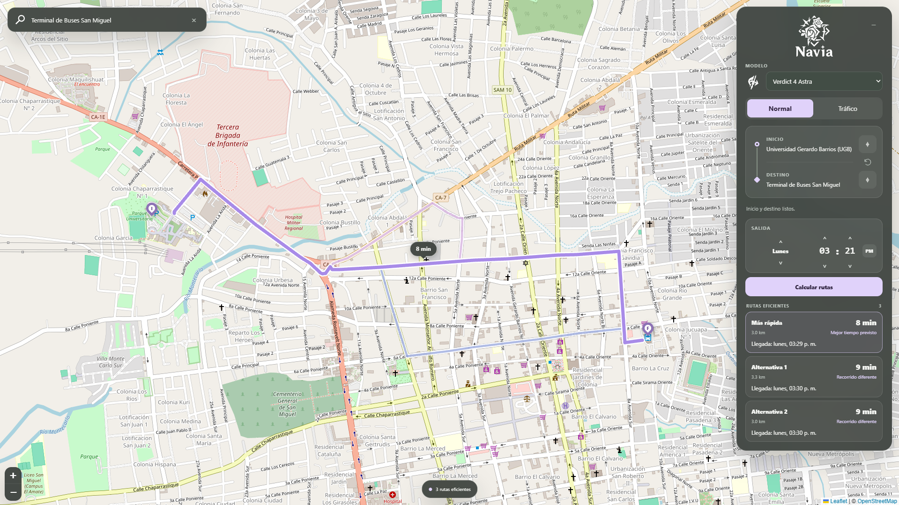
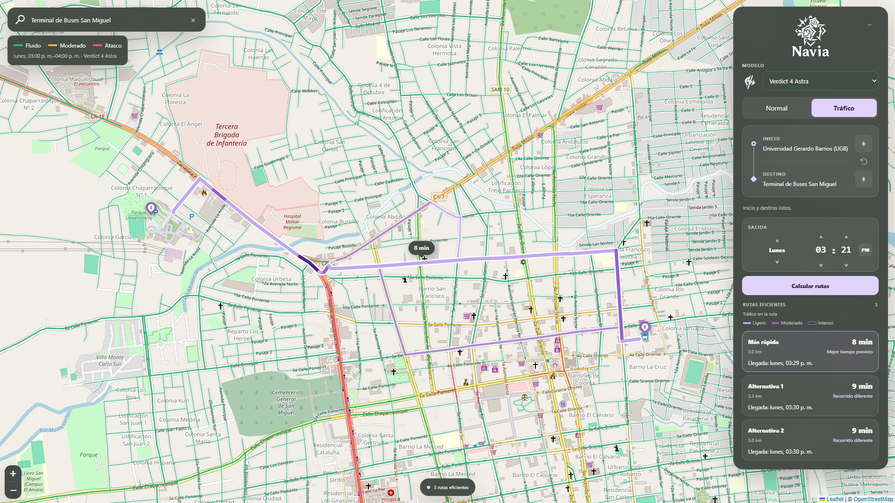

  

  <h3>Navegación Adaptativa Vial con Inteligencia Artificial</h3>

  

    
    
    
    
    
  

  
<strong>v0.1.5 · Helm of the Radiant Rose</strong>

##  ¿Qué es Navia?

Navia es un planificador de rutas para El Salvador que combina una red vial local con estimaciones de tráfico para encontrar recorridos con menor tiempo de viaje

Las carreteras se evalúan según la hora prevista de paso por cada tramo. Si un viaje comienza a las 7:00 y llega a otra zona a las 11:00, Navia utiliza las condiciones estimadas para esa hora al calcular el recorrido

La ruta principal prioriza el tiempo total de llegada: puede atravesar tráfico si hacerlo resulta más rápido que evitarlo

##  Planifiación de rutas

##  Mapa de tráfico estimado

La vista tráfico permite explorar las condiciones estimadas para la fecha y hora seleccionadas:

- 🟢 **Fluido**
- 🟡 **Moderado**
- 🔴 **Atasco**

Las calles locales aparecen al acercarse al mapa para mantener una vista más clara al explorar zonas amplias

##  Características

- Hasta tres rutas con recorridos distintos, Navia muestra alternativas cuando encuentra opciones suficientemente diferentes y con tiempos competitivos.
- Estimación de viaje por tramo, Verdict 4 Astra usa franjas de 15 minutos para estimar el tráfico a la hora prevista de paso por cada tramo e incorpora las esperas en cruces y semáforos.
- Planificación por hora y día, después del primer cálculo, Navia actualiza las rutas automáticamente si cambias la salida.
- Búsqueda de lugares con OpenStreetMap, Busca una ubicación y úsala directamente como inicio o destino.
- Mapa de tráfico por tramos. En modo Tráfico, los colores de la ruta indican la congestión estimada. En modo Normal, cada ruta mantiene un color sólido.
- Duración visible sobre el mapa, La ruta seleccionada destaca con un borde blanco y muestra su tiempo estimado en una burbuja.
- Cálculo local en CPU, la estimación del tráfico y el cálculo de rutas se ejecutan localmente en tu equipo.

---

##  Impulsado por Verdict 4 Astra

### 184,3 millones de parámetros espaciotemporales

Parámetros estadísticos que representan el tráfico mediante combinaciones de:

- 274.229 tramos de carretera
- 7 días de la semana
- 96 franjas diarias de 15 minutos

Cada combinación también tiene una probabilidad de tráfico moderado y otra de atasco.

## Información extra

Puede obtener más información técnica sobre el proyecto consultando nuestro PDF informativo haciendo clic <a href="docs/Info.pdf">aquí</a>
 
Puede ver los avances del proyecto consultando nuestro PDF informativo haciendo clic <a href="docs/Info1.5.pdf">aquí</a>

##  Instalación

### Requisitos

- Windows
- Python 3.12+
- Conexión a Internet para instalar las dependencias

<strong>Librerías y versiones</strong>

Las dependencias de Python se instalan automáticamente al ejecutar `Navia.bat`.

| Librería | Versión |
|---|---|
| Flask | 3.1.3 |
| NumPy | 2.5.4 |
| Numba | 0.68.0 |
| Shapely | 2.2.0 |
| PyArrow | 26.0.0 |
| PyProj | 3.8.0 |
| RapidFuzz | 3.14.6 |
| Blinker | 1.9.0 |
| Certifi | 2026.10.19 |
| Click | 8.5.0 |
| ItsDangerous | 2.2.0 |
| Jinja2 | 3.1.6 |
| LLVMLite | 0.50.0 |
| MarkupSafe | 3.0.4 |
| Werkzeug | 3.1.9 |

<strong>Librerías y versiones</strong>

Las dependencias de Python se instalan automáticamente al ejecutar `Navia.bat`.

| Librería | Versión |
|---|---|
| Flask | 3.1.3 |
| NumPy | 2.5.4 |
| Numba | 0.68.0 |
| Shapely | 2.2.0 |
| PyArrow | 26.0.0 |
| PyProj | 3.8.0 |
| RapidFuzz | 3.14.6 |
| Blinker | 1.9.0 |
| Certifi | 2026.10.19 |
| Click | 8.5.0 |
| ItsDangerous | 2.2.0 |
| Jinja2 | 3.1.6 |
| LLVMLite | 0.50.0 |
| MarkupSafe | 3.0.4 |
| Werkzeug | 3.1.9 |

### Descargar e instalar Navia

1. Descargar el paquete completo desde [Releases](https://github.com/SpringdanceShrub/Navia/releases) y extraer el ZIP
2. Hacer dobre click sobre **`Navia.bat`**
3. Espera mientras prepara el entorno y abre Navia en el navegador

Para volver a usar Navia, ejecuta otra vez `Navia.bat`. Reutiliza el entorno y las dependencias instaladas. Si cambian las versiones requeridas o falta alguna biblioteca, actualiza la instalación automáticamente. Mantenga la ventana abierta mientras utilizas la aplicación. Para detenerla, pulsa Ctrl + C.

La dirección habitual es http://127.0.0.1:8000. Si ya hay una instancia de Navia en ese puerto, abre la existente, si el puerto pertenece a otro programa, intenta utilizar otro disponible y muestra su dirección.

**La primera consulta puede tardar más por la carga del modelo y la compilación para CPU. Si el navegador no se abre, utiliza la dirección que aparece en la ventana.**

##  Uso

1. Selecciona el modelo de tráfico
2. Utiliza los botones de Inicio y Destino para elegir ambos puntos en el mapa
3. Ajusta la fecha y hora de salida
4. Pulsa Calcular rutas
5. Selecciona una de las opciones para destacar su recorrido y consultar su tiempo estimado
6. Cambia entre Normal y Tráfico para explorar las condiciones previstas

La vista de tráfico muestra las condiciones de la hora seleccionada. Los tiempos de las rutas consideran las condiciones a la hora de paso por cada tramo

##  Consideraciones

> Las predicciones se basan en datos sintéticos apoyados en referencias parciales de tráfico habitual. No representan tráfico en tiempo real y pueden diferir de las condiciones reales

- La primera consulta puede tardar más mientras se carga el modelo y se prepara el cálculo en CPU
- Los tiempos de viaje son estimaciones. Accidentes, obras, clima y otros eventos pueden modificar las condiciones reales
- Navia está en fase beta y puede tener errores

## Miembros del equipo

- Abdiel Alfredo Hernández Vásquez - SMSS077825
- Ruth Isabel Amaya Berríos - SMSS061025
- William Daniel Roque Díaz - SMSS025025

## Licencias y atribución

- Navia: [Apache 2.0](LICENSE).
- Datos viales, mapa y búsquedas · © OpenStreetMap contributors distribuidos mediante BBBike y Geofabrik: [ODbL 1.0](https://opendatacommons.org/licenses/odbl/1-0/) · [Atribución y fuentes](data/README.md).
- Fondo de países y costas · Natural Earth: [Dominio público](https://www.naturalearthdata.com/about/terms-of-use/).
- Límites de El Salvador y sus departamentos · geoBoundaries gbOpen, basados en OpenStreetMap: [CC BY-SA 2.0](https://creativecommons.org/licenses/by-sa/2.0/).
- Leaflet: [Licencia BSD](frontend/vendor/leaflet/LICENSE).
- MapLibre GL JS: [Licencia BSD](frontend/vendor/offline-map/licenses/MapLibre-BSD.txt).
- Adaptador MapLibre para Leaflet: [Licencia ISC](frontend/vendor/offline-map/licenses/Leaflet-MapLibre-ISC.txt).
- Fuentes Noto Sans: [SIL Open Font License 1.1](frontend/vendor/offline-map/licenses/NotoSans-OFL.txt).